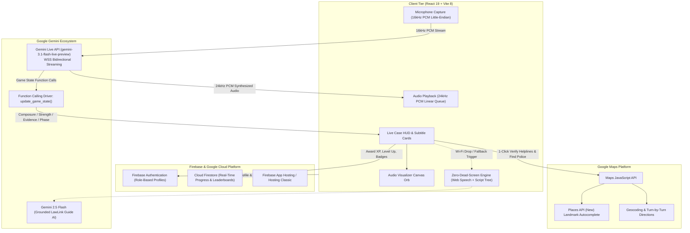

# LAWLINK

### *“Learn the Law. Recognize the Situation. Know What To Do.”*

A gamified, production-grade legal literacy and civic safety platform built for the **GDG on Campus Hackathon**.

LAWLINK bridges the gap between intimidating, complex statutory text and practical everyday citizen confidence. Instead of forcing users to read endless legal sections, LAWLINK provides an **interactive, decision-driven journey**:

> **The LawLink Philosophy:**  
> Traditional Legal Websites: `READ → SEARCH → EXIT`  
> **LAWLINK:** `EXPERIENCE → UNDERSTAND → PRACTICE → ACT → GET HELP`

---

## 🌟 Key Features & Architecture Highlights

### 🎙️ 1. [FLAGSHIP] Live Case Mode: Voice-First Game-Engine Powered by Gemini Live API
- **Real-Time Voice Duplex Simulation:** Face off against aggressive scam callers, deceptive e-commerce customer support agents, overstepping traffic officers, and hostile corporate employers.
- **Powered by Google Gemini Live API (`gemini-3.1-flash-live-preview`):**
  - **16kHz 16-bit PCM Input:** Real-time microphone capture via Web Audio API.
  - **24kHz 16-bit PCM Output:** Ultra-low latency voice streaming with dynamic visualizer orb.
  - **Barge-In Interruption:** Cutting off the caller mid-sentence immediately silences audio buffer playback and updates session context.
  - **Function Calling Game Driver:** The Gemini model dynamically calls `update_game_state(composure_delta, legal_strength_delta, phase, evidence_unlocked, trap_triggered, reason)` in real time to steer the HUD.
- **Dynamic Game HUD & Audio Feedback:**
  - **Composure Meter (0-100%):** Dips on hesitation, panics, or compliance with traps; recovers on confident statutory pushback.
  - **Legal Strength Meter (0-100%):** Charges up when citing verified laws (e.g., BNS Sec 318, RBI Zero Liability Circular, CPA 2019 Sec 2(47), Rule 139 CMVR).
  - **4-Phase Investigation Progression:** Initial Pressure → Escalation → Statutory Counter → Resolution.
  - **Live Subtitle Strip with Statutory Cards:** Clickable highlighted statutory tags that open popup legal definitions without breaking call immersion.
  - **Hidden Evidence Auto-Tick Checklist:** Discovers caller inconsistencies (e.g. personal mobile number, refusal of written notice, UPI refund scam link) accompanied by synthesized audio ticks.
  - **Trap Buzzer & Tension Drone:** Web Audio API sound synthesis providing visceral acoustic feedback for penalties and high-stress moments.
- **End-Game Mastery & Real-World Playbook:**
  - **Case Closed (Victory):** 1-3 Star rating, XP reward (+150-250 XP), badge unlocks (*Scam Slayer*, *Cool Under Pressure*, *Rights Ranger*), and an exportable **Real-World Action Playbook** integrating verified helplines (1930, 1915, 14449) and a 1-click jump to the Google Maps Legal Aid Finder.
  - **Case Lost (Coaching Recap):** Tactical debrief highlighting missed evidence items, triggered traps, and statutory rights to cite next time.
- **Zero-Dead-Screen Architecture (Guaranteed Hackathon Delivery):**
  - **Tier 1:** Full Bidirectional Gemini Live WebSocket duplex streaming.
  - **Tier 2:** Web Speech API + Gemini Flash REST fallback with voice synthesis.
  - **Tier 3:** Deterministic branching voice-script engine so the demo **never halts** even if venue Wi-Fi fails.
  - **Presenter Diagnostics & Shortcuts:** Pre-flight Demo Check modal (Mic, Audio, API, Latency) and presenter hotkeys (`Ctrl+Shift+D` or `~`) for immediate phase advance or force-win.

### 2. 🛡️ Real-Life Scenario Engine ("What Would You Do?")
- Interactive branching case dilemmas across **7 statutory domains**:
  1. **Cybercrime & Financial Fraud** (UPI scams, OTP phishing, SIM swaps, IT Act Sec 66D, RBI Zero Liability)
  2. **Consumer Rights & E-Commerce** (Defective goods, dark patterns, mandatory restaurant service charges, e-Daakhil)
  3. **Road Laws & Motor Vehicles Act** (Sec 134A Good Samaritan legal immunity, DigiLocker parity Rule 139 CMVR, virtual court e-challans)
  4. **Digital Privacy & Data Protection** (DPDPA 2023, Aadhaar biometric locking, predatory loan apps)
  5. **Fundamental Rights & Police Interactions** (Article 21, D.K. Basu arrest safeguards, Section 57 CrPC 24h limit)
  6. **Student Rights & Workplace Protections** (UGC anti-ragging regulations, POSH Act 2013, degree certificate retention ban)
  7. **Women’s Safety & Legal Safeguards** (Zero FIR nationwide mandate, Sec 46(4) CrPC sunset arrest safeguards, Sakhi One Stop Centres)
- **Every decision returns a 6-part structured breakdown:**
  - `YOUR CHOICE` (Correct ✓ / Risky ⚠ / Critical Risk ✗)
  - `WHY THIS MATTERS` (Detailed rationale)
  - `LEGAL AWARENESS` (Statutory legal citation)
  - `WHAT TO DO NEXT` (Concrete immediate steps)
  - `WHAT EVIDENCE TO KEEP` (Screenshots, transaction reference IDs, unboxing videos)
  - `WHERE TO GET HELP` (Direct link to verified portal or helpline)
  - `SOURCE & VERIFICATION` (Audit badge with reviewer name and date)

### 3. 🤖 Grounded Google Gemini AI ("LawLink Guide")
- Powered by `@google/genai` using `gemini-2.5-flash`.
- **Zero-Hallucination Guardrails:** AI answers are grounded strictly in the application's curated statutory knowledge layer. Gemini is strictly prohibited from inventing sections, case law, or phone numbers.
- **Voice Input:** Integrated browser Speech Recognition API (`webkitSpeechRecognition`) with live microphone recording.
- **Mandatory Safety Disclaimers:** Explicitly marked as educational awareness, not formal legal representation.

### 4. 🗺️ Google Maps Platform & Places API
- **Address Autocomplete:** Instant search for landmarks (e.g. *"GRIET Hyderabad"*, *"Nizampet"*, *"Connaught Place"*, *"BKC Mumbai"*).
- **Find Legal Help Near Me:** Interactive map with customized markers for Cyber Police Stations, District Legal Services Authorities (DLSA), Consumer Dispute Redressal Commissions, and Sakhi Crisis Centres.
- **Distance Calculation:** Haversine formula calculation (in km) with direct turn-by-turn navigation in Google Maps (`https://www.google.com/maps/dir/...`).
- **Graceful Fallback:** Seamless experience when location permission is denied.

### 5. 🎮 Real Persistent Gamification Engine
- **Cloud Firestore Backed:** User XP, Level, Streak, Completed Scenarios, and Badges are saved to Firestore under `progress/{uid}` and `userAchievements/{uid}/items`.
- **Level Tiers:**
  - *Level 1 — Aware* (0 - 299 XP)
  - *Level 2 — Informed* (300 - 699 XP)
  - *Level 3 — Practical* (700 - 1,199 XP)
  - *Level 4 — Rights Ready* (1,200 - 1,999 XP)
  - *Level 5 — LawLink Champion* (2,000+ XP)
- **Civic Badges:** *Scam Slayer* (Live Case), *Cool Under Pressure* (Live Case), *Rights Ranger* (Live Case), *Cyber Guardian*, *Consumer Champion*, *Road Ready*, *Privacy Protector*, *Rights Explorer*, *Safety Smart*, *Civic Defender*, *Streak Master*, *LawLink Champion*.
- **Celebration Feedback:** Integrated `canvas-confetti` celebrations upon leveling up, badge unlocking, and quiz completion.

### 6. ⚡ 3-Minute Judge Demo Mode
- A dedicated top-bar button (`⚡ 3-Min Judge Demo`) guiding hackathon judges through an interactive tour of the platform.

### 6. 🔒 Strict Account Isolation & Multi-Device Sync
- When **User A** creates an account, only User A's data appears.
- When **User B** signs up, User B starts with a clean profile (0 XP, no badges).
- Changes made on Device A immediately reflect on Device B via Firestore real-time listeners (`onSnapshot`) and cross-tab synchronization.

### 7. 🔑 Official Test Account Credentials (Ready to Test)

The application includes pre-configured verified credentials for evaluating multi-device account isolation and role-based views. You can log in manually with email & password, or use the **"Credentials"** button in the navbar for 1-click fast sign-in:

| Persona / Role | Name | Email | Password | Evaluation Purpose |
|---|---|---|---|---|
| **Citizen Learner** | Priya Sharma | `priya.sharma@lawlink.org` | `Citizen@123` | Active citizen learner (450 XP, 4-day streak, Cybercrime & Road Laws mastered) |
| **College Student** | Arjun Patel | `arjun.patel@lawlink.org` | `Student@123` | Clean-slate test account (0 XP) to test fresh onboarding & zero-loss progress |
| **Legal Aid Volunteer** | Kavita Desai | `kavita.desai@lawlink.org` | `Legal@123` | Community para-legal volunteer (850 XP, 7-day streak, Women Safety & Zero FIR expert) |
| **Statutory Admin** | Adv. Rajesh Kumar | `admin@lawlink.org` | `Admin@1234` | Full access to Admin Console, Content Audit, and Cloud Firestore seeder |

## 🛠️ Technology Stack (Powered by Google)

| Layer | Technology | Role & Integration |
|---|---|---|
| **Voice-First AI** | **Google Gemini Live API** (`gemini-3.1-flash-live-preview`) | Bidirectional WebSocket duplex audio (16kHz in / 24kHz out), real-time barge-in interruption, and function calling game-state driver (`update_game_state`) |
| **Grounded Advisory AI** | **Google Gemini 2.5 Flash** (`@google/genai`) | Low-latency statutory guidance, zero-hallucination guardrails, and speech-to-text fallback |
| **Cloud Database** | **Google Cloud Firestore** | Real-time persistence for XP, levels, streaks, live case achievements, and cross-tab synchronizations |
| **Authentication** | **Firebase Authentication** | Multi-account isolation (Email/Password, Google Sign-In) and fast test-profile switching |
| **Mapping & Routing** | **Google Maps Platform** | Interactive Legal Aid Finder, Places API (New) Autocomplete, and Geocoding directions |
| **Frontend Framework** | **React 19 + Vite 8** | High-performance reactive state management and sub-second asset bundling |
| **Audio Processing** | **Web Audio API** | Real-time 16kHz PCM downsampler, 24kHz PCM linear audio queue, and algorithmic sound synthesizers |
| **Styling & UI** | **Vanilla CSS Design System** | Custom Glassmorphism, CSS variables, and fluid responsive layouts (No Tailwind) |
| **Localization** | **Multi-Language Engine** | Live trilingual support across English, Hindi (हिंदी), and Telugu (తెలుగు) |

---

## 🏛️ "Powered by Google" System Architecture



---

## ⏱️ 2-Minute Presenter Demo Script (Hackathon Winning Flow)

Follow this exact step-by-step walkthrough during your live judging presentation to deliver a memorable, high-impact demonstration.

### Setup (T-minus 30 seconds)
1. Ensure microphone permission is granted in the browser.
2. In the navbar, click **"Live Cases"** (or click **"Launch Voice Demo"** directly from the Dashboard).
3. *(Optional)* Click **"Pre-Flight Check"** to show judges the diagnostic test verifying Mic, Audio output, Gemini API connectivity, and ping latency in under 2 seconds.

---

### Step 1: The Hook & Incoming Call (0:00 – 0:30)
- **Presenter says to judges:**  
  *"Judges, traditional legal websites offer dry paragraphs that nobody remembers during a panic. LawLink’s flagship innovation is **Live Case Mode**—an adrenaline-fueled, voice-first simulator powered by the Google Gemini Live API. Let’s face an aggressive scam caller right now."*
- **Action:** Click **"Start Live Voice Case"** on *"The Fake Bank Call (Flagship Demo Edition)"*.
- **Immersion:** The phone begins ringing with realistic telephone audio. Click the green **"Answer"** button.

---

### Step 2: The Pressure & First Legal Pushback (0:30 – 1:00)
- **Scam Caller (Officer Sharma) says:**  
  *"This is Senior Officer Sharma from SBI Central Fraud Cell. We have detected suspicious transactions on your account. Download AnyDesk and share the OTP immediately or your account will be frozen permanently within 10 minutes!"*
- **Observation:** Notice the **Composure Meter** is under stress, and the canvas **Audio Visualizer Orb** pulses dynamically with the caller's voice.
- **Presenter speaks into microphone:**  
  *"First of all, what is your official Employee ID and which branch are you calling from? Under RBI Master Directions, banks never ask for OTPs or remote screen-sharing apps."*
- **Result:**  
  - The Gemini Live model recognizes the statutory citation.
  - A satisfying chime plays as **Evidence #1 ("Refusal of Written Notice / RBI Non-Compliance")** auto-ticks in the checklist.
  - **Legal Strength Meter** surges from 50% to 65%.
  - The caller stumbles: *"Uh... sir, this is emergency procedure, I don't need to give you notice..."*

---

### Step 3: Invoking the Bharatiya Nyaya Sanhita (1:00 – 1:35)
- **Presenter speaks into microphone:**  
  *"Under Bharatiya Nyaya Sanhita Section 318(4) for digital fraud and Section 66D of the IT Act, impersonating a bank officer is a cognizable offence. I am recording this call and immediately reporting your number to the 1930 Cyber Fraud Helpline."*
- **Result:**  
  - Live subtitle strip highlights `[BNS Sec 318(4)]` and `[1930 Cyber Helpline]`. Clicking either chip opens a clean popup legal card without interrupting the voice flow.
  - **Legal Strength Meter** hits 90%+.
  - The scammer panics: *"Wait... don't do that..."* and abruptly hangs up!

---

### Step 4: Case Closed & Real-World Playbook (1:35 – 2:00)
- **Result Screen:**  
  - Triumphant victory fanfare plays.
  - **3 Stars Awarded!**
  - **+200 XP** added directly to the user's persistent Cloud Firestore profile.
  - **"Scam Slayer" & "Cool Under Pressure"** badges unlocked with confetti celebration!
- **The Climax (Real-World Action Playbook):**  
  *"And here is where LawLink transforms learning into action: The platform outputs a personalized **Real-World Action Playbook** detailing the 1930 Golden Hour protocol, verified evidence to preserve, and a 1-click button to **Find Nearest Cyber Police Station** via Google Maps Platform!"*
- **Action:** Click **"Find Cyber Police Station"** → immediately switches to the interactive Google Map with nearby law enforcement markers and direct routing!

---

### 🛡️ Presenter Fail-Safe Cheat Codes (Hidden Hotkeys)
If conference Wi-Fi is unstable or the judging slot is cut short, use the built-in presenter shortcuts:
- Press **`Ctrl + Shift + D`** (or press the **`~`** tilde key) to open the **Presenter Quick Controller**:
  - `Force Next Phase`: Instantly advances dialogue to Phase 3/4.
  - `Force Evidence Tick`: Simulates discovering caller inconsistencies.
  - `Force Victory`: Immediately launches the 3-star victory screen and playbook.
  - `Toggle Fallback`: Switches from Gemini Live WebSocket to offline deterministic dialogue tree.

---

## 📁 Firestore Database Schema

```text
users/{uid}                                -> User authentication records
profiles/{uid}                             -> Display name, avatar, preferred language, role
topics/{topicId}                           -> 7 Curated statutory modules
scenarios/{scenarioId}                     -> 14+ Branching real-life case studies
quizQuestions/{questionId}                 -> 35+ Statutory knowledge questions
resources/{resourceId}                     -> 20+ Verified government helplines & legal aid
progress/{uid}                             -> User XP, Level, Streak, completed arrays
progress/{uid}/topicProgress/{topicId}     -> Per-topic progress status
quizAttempts/{attemptId}                   -> Audit log of user quiz scores & percentages
userAchievements/{uid}/items/{badgeId}     -> Unlocked badges with timestamps
learningHistory/{uid}/items/{activityId}   -> Chronological legal literacy timeline
guidanceSessions/{sessionId}               -> LawLink Guide AI consultation history
leaderboard/{uid}                          -> Public leaderboard ranking document
contentVerification/{contentId}            -> Audit timestamps and legal reviewer stamps
```

---

## 🚀 Quick Start (Local Development)

### Prerequisites
- Node.js (v18 or higher)
- npm (v9 or higher)

### 1. Clone & Install Dependencies
```bash
git clone <repository-url>
cd HACKOBER
npm install
```

### 2. Configure Environment Variables
Copy `.env.example` to `.env`:
```bash
cp .env.example .env
```

Open `.env` and fill in your keys (optional for initial demo evaluation):
```env
# Firebase Configuration (From Firebase Console)
VITE_FIREBASE_API_KEY=AIzaSy...
VITE_FIREBASE_AUTH_DOMAIN=your-app.firebaseapp.com
VITE_FIREBASE_PROJECT_ID=your-app-id
VITE_FIREBASE_STORAGE_BUCKET=your-app.appspot.com
VITE_FIREBASE_MESSAGING_SENDER_ID=123456789
VITE_FIREBASE_APP_ID=1:123456789:web:abcdef

# Google Gemini API Key (From Google AI Studio)
VITE_GEMINI_API_KEY=AIzaSy...

# Google Maps Platform API Key (With Places API enabled)
VITE_GOOGLE_MAPS_API_KEY=AIzaSy...
```

> **Note:** The application includes a **Resilient Dual-Engine**. If Firebase credentials are not provided, it seamlessly runs with an in-memory/cross-tab simulated Cloud Data Engine with real seed data, UID account isolation, and cross-tab real-time sync, so you can test immediately without any initial blockers!

### 3. Run Development Server
```bash
npm run dev
```
Open [http://localhost:5173](http://localhost:5173) in your browser.

---

## ☁️ Google Cloud & Firebase Setup Guide

### Step 1: Create a Firebase Project
1. Go to the [Firebase Console](https://console.firebase.google.com/).
2. Click **Add project**, name it `lawlink-platform`, and proceed.
3. In Project Overview, click the **Web icon (`</>`)** to register a web app.
4. Copy the `firebaseConfig` keys into your `.env` file.

### Step 2: Enable Firebase Authentication
1. In the Firebase Console left menu, navigate to **Build → Authentication**.
2. Click **Get Started**.
3. Under **Sign-in method**, enable:
   - **Email/Password**
   - **Google** (Configure the project support email).

### Step 3: Create Cloud Firestore Database
1. Navigate to **Build → Firestore Database**.
2. Click **Create database**.
3. Select **Production Mode** and choose a location (e.g. `asia-south1` for India).
4. Deploy the security rules from `firestore.rules` (see below).

### Step 4: Deploy Firestore Security Rules
Use the Firebase CLI or paste the contents of [`firestore.rules`](./firestore.rules) into the Firebase Console Rules tab:
```bash
npx -y firebase-tools@latest deploy --only firestore:rules
```

### Step 5: Seed Cloud Firestore with Live Data
1. Open the LawLink application in your browser.
2. Sign in with the Admin account (`admin@lawlink.org`) or click **Switch Test Profile → Adv. Rajesh Kumar (Legal Lead)**.
3. Open the **Admin** console from the navbar.
4. Click **Cloud Firestore Seeder → Push Seed Data to Cloud**.
5. All 7 topics, 14+ scenarios, 35+ quizzes, and 20+ resources will be written directly to your Cloud Firestore instance!

---

## 🗺️ Google Maps Platform Setup

1. Go to the [Google Cloud Console](https://console.cloud.google.com/).
2. Select your project and navigate to **APIs & Services → Library**.
3. Enable the following APIs:
   - **Maps JavaScript API**
   - **Places API (New)**
   - **Geocoding API**
4. Navigate to **APIs & Services → Credentials** and click **Create Credentials → API Key**.
5. **API Key Restrictions:**
   - Under *Application restrictions*, select **Websites** and add `http://localhost:*` and your production domain.
   - Under *API restrictions*, select only the 3 enabled Google Maps APIs above.
6. Paste the key into `VITE_GOOGLE_MAPS_API_KEY` in `.env`.

---

## 🤖 Google Gemini AI Setup

1. Visit [Google AI Studio](https://aistudio.google.com/).
2. Click **Get API key** and generate a key for your project.
3. Paste the key into `VITE_GEMINI_API_KEY` in `.env`.
4. The application uses `gemini-2.5-flash` with low temperature (`0.2`) and strict grounding context to ensure factual accuracy and zero hallucinations.

---

## 🌐 Deployment to Firebase Hosting

```bash
# Build production bundle
npm run build

# Initialize Firebase hosting (if not done)
npx -y firebase-tools@latest init hosting

# Deploy
npx -y firebase-tools@latest deploy --only hosting
```

---

## ⚖️ Legal Disclaimer

*LawLink is an educational legal-literacy platform designed to empower citizens with awareness of statutory rights and official dispute-resolution mechanisms. LawLink does not provide formal legal advice or legal representation. In critical or hazardous situations, always contact emergency helplines (112) or consult a qualified legal professional.*
